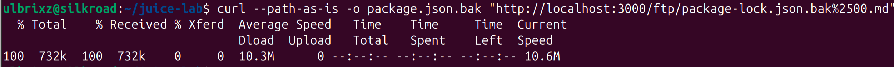
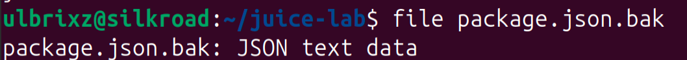
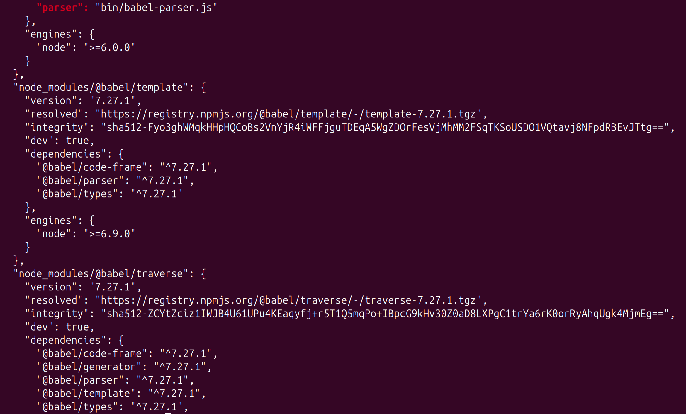
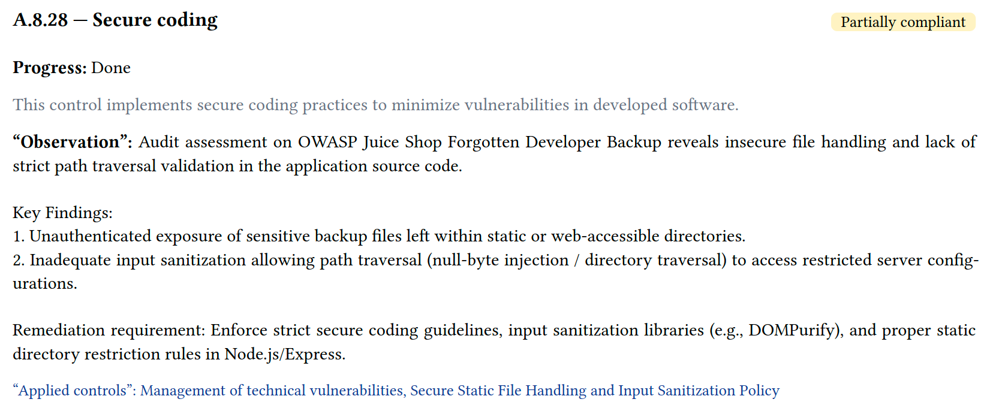
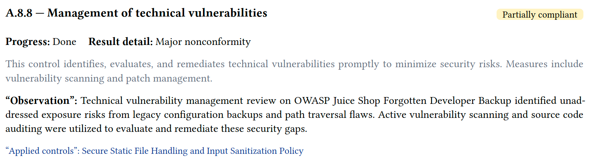

# Security Requirements Document (SRD) & Security Response Plan (SRP)
## Case Study: Forgotten Developer Backup Remediation

> **DISCLAIMER & ETHICAL STATEMENT**  
> This project is a security analysis study, risk governance framework mapping, and security requirements engineering exercise (GRC Documentation) using **OWASP Juice Shop** (a locally hosted lab environment intentionally deployed on Ubuntu Linux for educational purposes). This document does not represent security testing conducted on unauthorized or commercial enterprise systems.

---
## 1. Executive Summary

This document outlines the technical security evaluation, risk assessment, **Security Requirements Document (SRD)**, and **Security Response Plan (SRP)** addressing an identified **Sensitive Data Exposure via Forgotten Developer Backup** vulnerability within the OWASP Juice Shop application (`/ftp/package.json.bak`).

The primary objective of this documentation is to analyze the mechanics of bypassing file extension restrictions via **Poison Null Byte (`%2500.md`) URI manipulation**, establish access control & static file serving requirements (Express.js), and map the risk lifecycle to **ISO/IEC 27001:2022** and **NIST CSF v2.0** enterprise frameworks.

---

## 2. Risk & Impact Analysis & Risk Treatment Plan

| Parameter | Initial Assessment (Pre-Mitigation) | Post-Mitigation (Residual Risk) |
| :--- | :--- | :--- |
| **Vulnerability** | Exposure of Backup File Containing Sensitive Information (CWE-530 / CWE-200) | Remediated / Neutralized |
| **CVSS v3.1 Score** | **5.3 (MEDIUM)** (`CVSS:3.1/AV:N/AC:L/PR:N/UI:N/S:U/C:L/I:N/A:N`) | **0.0 (NONE)** |
| **Risk Treatment Strategy** | N/A | **Risk Reduction (Mitigation)** |
| **Risk Owner** | Lead Backend Engineer / Lead DevSecOps | Head of Information Security (Sign-off) |
| **Remediation SLA** | **7 Business Days** (Medium Severity Standard) | Verified & Closed |

### 2.1 Technical & Business Impact
* **Software Bill of Materials (SBOM) Leakage**: Exposure of `package.json.bak` reveals exact dependency versions (`body-parser`, `express-jwt`, `grunt`, etc.), enabling attackers to map known CVEs against outdated third-party packages.
* **Bypass Mechanics**: Web application routing filters intended to restrict non-markdown assets are bypassed using URL-encoded null byte injection (`%2500.md`).

---

## 3. Compliance Framework Mapping

| Standard Framework | Control ID & Name | Strategic Alignment Description |
| :--- | :--- | :--- |
| **ISO/IEC 27001:2022** | **Annex A.8.28** (Secure Coding) | Mandates input sanitization and secure static file routing options to prevent bypass techniques like Poison Null Byte injection. |
| **ISO/IEC 27001:2022** | **Annex A.8.8** (Management of Technical Vulnerabilities) | Establishes formal scanning and cleanup procedures to detect and remove residual backup files (`.bak`, `.old`, `.swp`) prior to production deployment. |
| **NIST CSF v2.0** | **PR.DS-01** (Data Security) | Enforces protective controls safeguarding application metadata, source configuration backups, and sensitive dependency manifests. |
| **NIST CSF v2.0** | **DE.CM-01** (Continuous Monitoring) | Requires continuous static analysis and secret scanning to detect unlinked developer artifacts within public storage trees. |

---

## 4. Proof of Concept (PoC) & Execution Evidence

1. **Vulnerability Mechanics**:  
   Developer backup files (`package.json.bak`) remain stored within publicly accessible storage directories (`/ftp/`). While web application rules enforce file access validation (restricting downloads to specific extensions like `.md` or `.pdf`), a **Poison Null Byte (`%2500.md`)** payload truncates backend URI validation, permitting direct retrieval.

2. **Exploitation Steps (Ubuntu Linux Environment)**:
   * **Step 1 (Null Byte Payload Crafting)**: Execute a crafted HTTP `GET` request using `curl` while retaining raw path structure (`--path-as-is`):
     ```bash
     curl --path-as-is -o package.json.bak "http://localhost:3000/ftp/package.json.bak%2500.md"
     ```
   * **Step 2 (Data Verification)**: Inspect the downloaded file using standard Linux utilities (`file` and `cat`):
     ```bash
     file package.json.bak
     cat package.json.bak
     ```

3. **Execution Evidence (Visual Proofs)**:

   * **Null Byte curl Request Execution**:  
     Successful retrieval of `package.json.bak` via `curl --path-as-is` command.  
     

   * **Exposed package.json.bak Content**:  
     Inspection of project metadata, author info, and contributors using `cat`.  
     

   * **Sensitive Asset Content Inspection (Dependency Map)**:  
     Full exposure of internal software dependencies and version numbers.  
     

---

## 5. Security Requirements Document (SRD) & Technical Remediation

### 5.1 Express.js Static Routing Hardening
Because OWASP Juice Shop operates on a **Node.js / Express.js** stack, remediation must target both file retention policies and framework middleware options.

```javascript
// Secure Express static file configuration preventing dotfile/backup exposure
app.use('/ftp', authenticateUser, express.static('ftp', {
    index: false,        // Disables automatic directory indexing
    dotfiles: 'ignore',  // Completely ignores hidden files (.bak, .swp, .env)
    fallthrough: false   // Prevents path truncation/null byte fallthrough attacks
}));
```

### 5.2 Build-Time Artifact Cleanup (DevOps Cleanup)
Automated build pipelines must sanitize workspace directories before building production container images:
* Add `.bak`, `.old`, `.swp`, and `package.json.bak` to `.gitignore` and `.dockerignore`.
* Implement a pre-build script command: `find . -type f \( -name "*.bak" -o -name "*.old" \) -delete`.

### 5.3 Automated Security Controls & Repository Linters (CI/CD Integration)

To prevent the introduction of unmanaged backup artifacts and ensure proactive alignment with **ISO/IEC 27001:2022 Annex A.8.9** and **NIST CSF v2.0 PR.DS-01**, automated validation checks must be enforced across two distinct layers:

1. **Repository Linters & Pre-Commit Hooks (Artifact Prevention)**:
   * Implement local `pre-commit` hooks or lightweight CI validation scripts to enforce block rules that immediately reject commits or pull requests containing forbidden backup or temporary file extensions (`.bak`, `.old`, `.swp`).
   * *Example CI Enforcement Script*:
     ```bash
     # Block commit if backup/old extensions are detected in staging area
     if git diff --cached --name-only | grep -E '\.(bak|old|swp)$'; then
         echo "[ERROR] Security Policy Violation: Backup files (.bak, .old) are prohibited in repository."
         exit 1
     fi
     ```

2. **Secret Scanning Integration (Content Analysis)**:
   * Utilize specialized **Secret Scanners** (such as **TruffleHog** or **GitGuardian**) integrated into the GitHub Actions pipeline. 
   * *Purpose*: While file linters handle extension block rules, TruffleHog/GitGuardian are deployed specifically to scan the *internal contents* of any legacy or configuration files for accidentally hardcoded staging database credentials, API tokens, or encryption keys.
---

## 6. Security Response Plan (SRP) - Operational Incident Handling Procedures

### Phase 1: Triage & Identification
* Monitor WAF access logs for URI patterns containing double-encoded null bytes (`%2500`, `%00`) combined with backup extensions targeting public routes (`/ftp/`).

### Phase 2: Containment
* Instantly block requests containing null byte strings at the edge reverse proxy / WAF level.
* Remove residual `.bak` files from the active application web root.

### Phase 3: Eradication & Recovery
* Purge developer backup files from deployment artifacts and update `.dockerignore`.
* **Operational Risk Mitigation Note**: *If storage path modifications or dependency manifest file cleanups affect legacy build tasks, coordinate deployment windows to test for build script regressions.*

### Phase 4: Lessons Learned
* Update DevSecOps code review checklists to enforce automated backup cleanup prior to merging PRs to `main`.

---

## 7. ISMS Governance & CISO Assistant Implementation

To maintain continuous ISMS oversight, this technical finding and its corresponding mitigation plan are registered within a self-hosted **CISO Assistant GRC Platform** running locally on Ubuntu Linux:

* **Perimeter**: Global / OWASP Juice Shop Web Application
* **Framework**: ISO/IEC 27001:2022 (Annex A.8.28 & A.8.8)
* **Status**: Remediated / Verified via Static Analysis & Route Verification

### Mapped Controls & Verification Evidence:

- **A.8.28 - Secure Coding**: Evaluates path traversal vulnerability and input validation mechanisms within application source code.
  

- **A.8.8 - Management of Technical Vulnerabilities**: Assesses handling and exposure risks of sensitive configuration backup files.
  
---

## About the Author

Ex-Product Manager pivoting into Governance, Risk, and Compliance (GRC). This repository demonstrates the practical application of technical vulnerability research mapped directly to enterprise security controls and compliance frameworks (ISO/IEC 27001 & NIST CSF).
